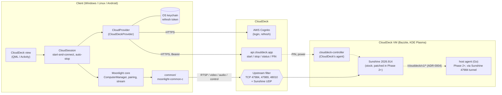

# Architecture

## Components

- **CloudProvider** (`client-desktop/app/clouddeck/`,
  `client-android/.../clouddeck/`): everything portal-specific, behind one
  interface. It enforces an endpoint allowlist, so `/reset`, billing and
  account changes are impossible.
- **CloudSession / CloudDeckActivity:** UI state and the start-and-connect
  sequence:
  1. machine `running`
  2. DNS points to `public_ip`
  3. Sunshine `serverinfo` answers
  4. pair if needed: client-generated PIN, submitted through the portal
  5. launch through Moonlight's own launcher (`CliStartStream::Launcher` /
     `ServerHelper.doStart`)
- **Moonlight core:** unchanged apart from branding (ADR-0005). Streaming,
  codecs, input and HDR are upstream code.
- **Host side** (Phase 2+): the patched Sunshine (ADR-0003) and the Go agent
  (ADR-0002), reached through Sunshine's HTTPS port because no other port
  gets past the filter (ADR-0004).

## Decisions

See [docs/adr/](adr/).
